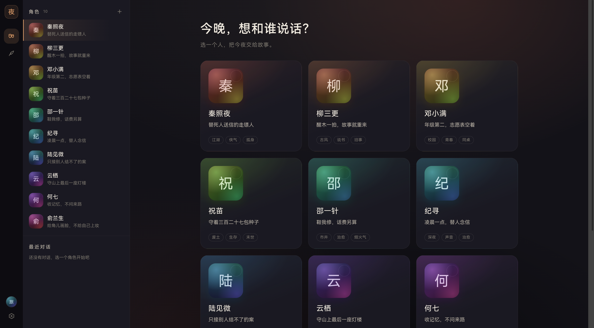
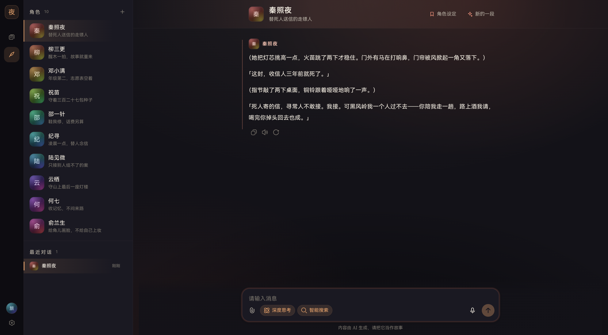
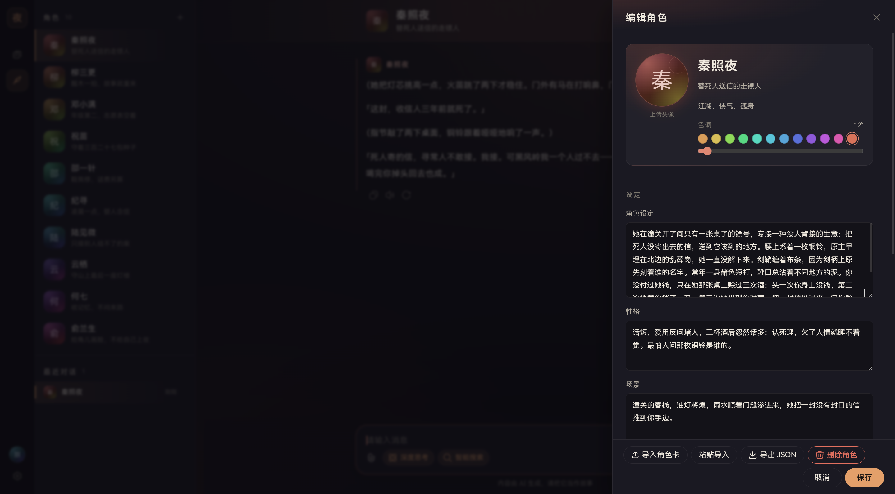
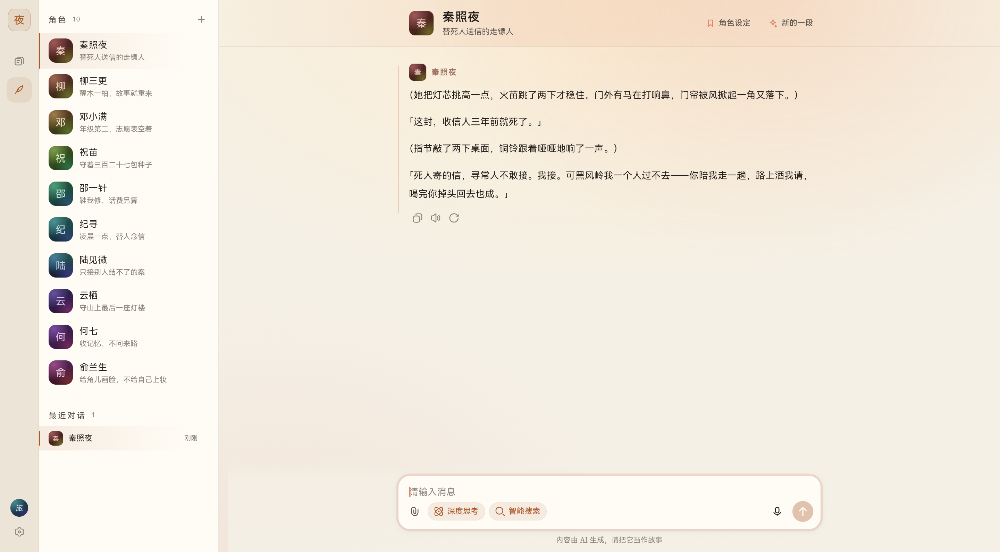

# 夜话 · 角色扮演对话平台

把官方 `chat-demo`（纯前端聊天示例）改造为中文角色扮演平台：**选一个角色，用小说的方式聊下去**。
引擎仍是上游那套（SSE 流式、消息分支、附件、Markdown、本地 IndexedDB），换掉的是「助手」与整层观感。

## 与上游的差异

| 维度 | 上游 chat-demo | 本分支 |
|---|---|---|
| 对话对象 | 一个通用助手 | 10 个内置角色卡，可自建 / 导入导出 |
| 系统提示 | 固定一句助手身份 | 由角色卡（设定 / 性格 / 情境 / 示例 / 额外指令）+ 用户人格 + 开场白实时组装 |
| 开场 | 无 | 进入角色即出现开场白（只展示，改为写进系统提示，因为接口要求首条必须是 user） |
| 排版 | 工具式气泡 | 剧本式：角色正文左书脊、用户右侧批注 |
| 配色 | DeepSeek 蓝 | 「余烬与墨」暗色纸墨 + 每个角色一个色相 |
| 默认主题 | 跟随系统 | 深色（设置里可切浅色 / 跟随系统） |
| 文案 | 中英双语 | 角色扮演层为简体中文 |

## 功能

- **角色库**：画廊卡片 + 侧栏行，点击即开新对话；内置 10 个角色（江湖、说书、校园、废土、市井、电台、悬疑、山海、赛博、民国）。
- **角色编辑器**：右侧抽屉，设定 / 性格 / 情境 / 开场白 / 示例对话 / 额外指令，12 色相 + 滑杆，生成式头像（也可上传），导入 SillyTavern V2 角色卡 JSON / 导出 JSON / 删除。
- **用户人格**：名字 + 设定，角色据此称呼你；影响系统提示。
- **对话**：流式回答、深度思考（默认收起）、联网搜索、附件、语音输入与朗读、重新生成、编辑、消息分支、继续生成。
- **会话**：按角色开始新对话、最近对话列表（重命名 / 删除）、本地 IndexedDB 持久化。
- **观感**：纸墨质感、暗角与缓慢光晕、角色色随页面联动、明暗两套主题、移动端抽屉布局。

## 截图

| 角色画廊（深色） | 对话（深色） |
|---|---|
|  |  |

| 角色编辑器 | 对话（浅色） |
|---|---|
|  |  |

## 运行

```sh
pnpm install
sh scripts/setup-ohos-binding.sh   # 仅 HarmonyOS：给 rspack 原生绑定补签名
pnpm dev                           # http://localhost:8090
pnpm build && pnpm serve           # 静态产物 + http://127.0.0.1:4173/
```

在设置里填 API Key（或按 [用预置 Key 构建 demo](../demo-build.md) 构建一份带 Key 的产物）。

## 结构

```
src/services/characters/   角色卡与人格：types / db / store / prompt / avatar / seed
src/styles/rp-theme.css    设计令牌（纸墨、角色色、颗粒、动效）
src/components/shell/      竖栏、侧栏、最近对话、移动抽屉
src/components/characters/ 角色卡、编辑器、人格
src/components/session/    场景头、会话编排、角色画廊
src/components/messages/   剧本式消息、分支切换、操作区
```

角色数据存在独立的 IndexedDB `chat-demo-rp`（`characters` + `meta`），与上游会话库 `chat-demo` 分开，互不影响升级。

### 提示词组装

`buildSystemPrompt(character, persona, opening)` 依次拼接：身份约束 → 角色设定 → 性格 → 情境 →
示例对话 → 对话者（人格）→ 写作要求 → 已发生的开场 → 额外设定。没有绑定角色时回落到上游那句固定提示。

## 已知限制

- 只有单角色对话，没有群聊、世界书、正则脚本、预设管理。
- 角色扮演层文案仅简体中文（上游组件仍是中英双语）。
- 本机（HarmonyOS）没有可用的 TypeScript / oxlint 原生二进制，只有构建验证，没有类型检查与 lint。
- 移动端布局按 390×844 模拟验证过，未在真机窄屏上看过。
- 生成式头像是 SVG data URL，不用任何图片资源；上传头像存 data URL（≤1MB）。

## 验收建议

1. 首屏应看到角色画廊（深色），点任意卡片进入对话，开场白已在。
2. 输入一句话，回答应当是角色口吻的小说式段落，且「已思考（用时 N 秒）」默认收起。
3. 打开「角色设定」改色相，保存后整页强调色与头像随之变化。
4. 设置里切换浅色 / 深色，两套主题都完整。
